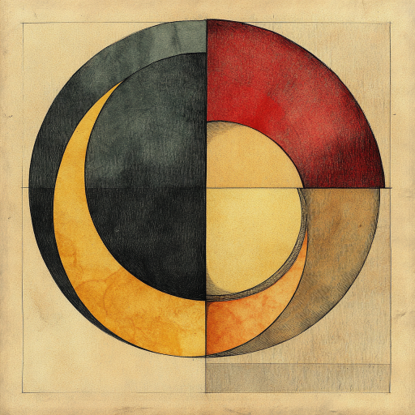

# The Focus AI

## Latest from labs.thefocus.ai

 - 2026-11-21: [Why Gemini 4 Feels Different From Claude and GPT](https://labs.thefocus.ai/reports/why-gemini-feels-different/)
 - 2026-11-18: [Adapting Qwen 3.8 27B to the π Coding Harness on Apple Silicon](https://labs.thefocus.ai/lab/qwen-3-8-pi-harness/)
 - 2026-11-17: [Repeatable Site Demo Reels with Claude Code, webreel, and Remotion](https://labs.thefocus.ai/recipes/site-trailers-with-webreel/)
 - 2026-11-16: [Practice leads to Theory](https://labs.thefocus.ai/dispatch/practice-leads-to-theory/)
 - 2026-11-12: [Full Multimodal Search Without the Data Leaving the Building](https://labs.thefocus.ai/reports/embeddinggemma-2-sqlite/)
 - 2026-11-11: [How AI in November 2026](https://labs.thefocus.ai/dispatch/how-ai-november-2026/)
 - 2026-11-02: [New productive forces. New organizations?](https://labs.thefocus.ai/reports/new-quality-productive-forces/)
 - 2026-09-20: [Jev: Judging, Not Calling Tools](https://labs.thefocus.ai/reports/jev-typed-judgments/)
 - 2026-09-03: [Never Touch the Laptop: Running a Whole Project from Your Phone](https://labs.thefocus.ai/reports/phone-first-cloud-agents/)
 - 2026-08-17: [whichllm: pick a local model that is actually fast](https://labs.thefocus.ai/dispatch/whichllm-speed-fast/)
 - 2026-08-04: [Where A2A Begins and Ends](https://labs.thefocus.ai/dispatch/where-a2a-begins-and-ends/)

## Our Claude Skills

 - 2026-07-14: [The-Focus-AI/google-skill](https://github.com/The-Focus-AI/google-skill) - Google services integration for Claude Code: Gmail, Calendar, Sheets, Docs, YouTube
 - 2026-07-07: [The-Focus-AI/nano-banana-cli](https://github.com/The-Focus-AI/nano-banana-cli) - A flexible CLI tool that uses Google's Gemini API to process images with customizable prompts. Perfect for batch processing slides, photos, and other images with AI-powered transformations.
 - 2026-07-07: [The-Focus-AI/focus-agents](https://github.com/The-Focus-AI/focus-agents) - Claude Code agents for research and engineering analysis
 - 2026-06-11: [The-Focus-AI/focus-ai-brand](https://github.com/The-Focus-AI/focus-ai-brand) - Claude Code skill for Focus.AI brand guidelines
 - 2026-04-15: [The-Focus-AI/chrome-driver](https://github.com/The-Focus-AI/chrome-driver) - Pure Perl Chrome DevTools Protocol library for browser automation - screenshots, PDFs, web scraping, form filling, and screen recording with zero dependencies
 - 2026-04-15: [The-Focus-AI/mdcopy](https://github.com/The-Focus-AI/mdcopy) - macOS: GitHub-Flavored Markdown to rich HTML on the clipboard for Mail, Docs, Slack, and Word. Uses Pandoc; includes a Claude Code plugin (mdcopy@focus-marketplace).
 - 2026-04-03: [The-Focus-AI/granola-skill](https://github.com/The-Focus-AI/granola-skill) - Claude Code plugin for accessing Granola meeting notes, transcripts, and summaries
 - 2026-03-30: [The-Focus-AI/pocketcast-skill](https://github.com/The-Focus-AI/pocketcast-skill) - Claude Code plugin for Pocket Casts — search episodes, starred content, show notes, and podcast metadata
 - 2026-03-30: [The-Focus-AI/twitter-skill](https://github.com/The-Focus-AI/twitter-skill) - Claude Code plugin for Twitter/X API - OAuth 2.0 PKCE, tweets, timeline, lists, engagement
 - 2026-02-19: [The-Focus-AI/focus-skills](https://github.com/The-Focus-AI/focus-skills) - Claude Code skills for Focus.AI development
 - 2026-02-19: [The-Focus-AI/focus-commands](https://github.com/The-Focus-AI/focus-commands) - Claude Code commands for Focus.AI project setup
 - 2026-02-19: [The-Focus-AI/plausible-skill](https://github.com/The-Focus-AI/plausible-skill) - Simple Node.js script and Claude skill for querying Plausible Analytics API
 - 2026-02-19: [The-Focus-AI/microsoft-skill](https://github.com/The-Focus-AI/microsoft-skill) - Microsoft Graph API skill for Claude Code and AI agents
 - 2026-02-16: [The-Focus-AI/quickbooks-skill](https://github.com/The-Focus-AI/quickbooks-skill) - Read-only access to QuickBooks Online data from Claude Code
 - 2026-02-11: [The-Focus-AI/marina-skill](https://github.com/The-Focus-AI/marina-skill) - Claude Code plugin for managing Hetzner Cloud servers, Cloudflare DNS, and Docker-based app deployments
 - 2026-01-24: [The-Focus-AI/embeddings-search-skill](https://github.com/The-Focus-AI/embeddings-search-skill) - Claude Code plugin for hybrid document search (grep + semantic embeddings)
 - 2026-01-17: [The-Focus-AI/buttondown-skill](https://github.com/The-Focus-AI/buttondown-skill) - Claude Code plugin skill for managing Buttondown newsletters - create drafts, schedule emails, view analytics

## Latest Focus Repo activity

 - 2026-11-22: [The-Focus-AI/umwelten](https://github.com/The-Focus-AI/umwelten) - CLI tool for evaluating and comparing AI models across Google, Ollama, OpenRouter, LM Studio, LlamaBarn, and GitHub Models. Features robust error handling, cost tracking, memory-augmented chat, and dynamic test coverage.
 - 2026-11-22: [The-Focus-AI/2026-11-ai-engineer-code-summit](https://github.com/The-Focus-AI/2026-11-ai-engineer-code-summit) - A live field guide to AI Engineer Code Summit 2026 (SF, Nov 10–12): schedule, recorded talks with Qwen transcripts, notes, stories, themes and speakers, kept current by an OpenProse pipeline.
 - 2026-11-18: [The-Focus-AI/standards](https://github.com/The-Focus-AI/standards) - The issuing authority for a fleet of agents — numbered, citable standards, guides, notes, decisions and skills, where rendering is the conformance check.
 - 2026-11-18: [The-Focus-AI/session-spec-verify](https://github.com/The-Focus-AI/session-spec-verify) - Modular conceptual spec extraction, evidence-backed deployment verification, and protected external-standard refactoring skills for cold-rebuildable software.
 - 2026-11-18: [The-Focus-AI/qwen-3.8-pi-adapted](https://github.com/The-Focus-AI/qwen-3.8-pi-adapted) - Serve Qwen3.8-27B with the Pi-adapted LoRA via llama.cpp, talk to it with project-local π, and bench with the inference-optimisation skill.
 - 2026-11-18: [The-Focus-AI/2026-10-ai-engineer-nyc](https://github.com/The-Focus-AI/2026-10-ai-engineer-nyc) - Public archive of AI Engineer New York 2026 (Oct 12–14) by TheFocus.AI: 8 themes, 31 talk stories, stage slides & 176 verbatim claims — https://the-focus-ai.github.io/2026-10-ai-engineer-nyc/
 - 2026-11-18: [The-Focus-AI/conference-reporter](https://github.com/The-Focus-AI/conference-reporter) - Template for an agent-run conference notebook: notes, Voice Memos recordings (local Qwen3-ASR), photos and the schedule become evidence-backed talk stories, theme syntheses and a static site, driven by OpenProse contracts with signed receipts.
 - 2026-11-18: [The-Focus-AI/2025-11-ai-engineer-code-summit](https://github.com/The-Focus-AI/2025-11-ai-engineer-code-summit) - Notes, slides, and analysis from the AI Engineering Code Summit (November 20, 2025)
 - 2026-11-15: [The-Focus-AI/trmnl-image-agent](https://github.com/The-Focus-AI/trmnl-image-agent) - Generate and push custom images to TRMNL e-ink displays
 - 2026-11-14: [The-Focus-AI/artifacts.thefocus.ai](https://github.com/The-Focus-AI/artifacts.thefocus.ai) - CLI-first Artifact publishing for TheFocus.AI.
 - 2026-11-14: [The-Focus-AI/walking-thoughts](https://github.com/The-Focus-AI/walking-thoughts) - 
 - 2026-11-12: [The-Focus-AI/gemmaembeddings](https://github.com/The-Focus-AI/gemmaembeddings) - Local EmbeddingGemma 2 multimodal benchmark lab & interactive SQLite (libSQL DiskANN + FTS5) playground
 - 2026-10-23: [The-Focus-AI/dsh-plugin-sidebar-workspace-names](https://github.com/The-Focus-AI/dsh-plugin-sidebar-workspace-names) - DeepSeek Harness sidebar plugin: shows the owning workspace name on a second line under each session title in the In one list view.
 - 2026-10-23: [The-Focus-AI/aranet4-bluetooth](https://github.com/The-Focus-AI/aranet4-bluetooth) - Aranet4 CO₂ monitor over Bluetooth LE — a Swift menu bar app and a Python CLI, plus the reverse-engineered BLE protocol

